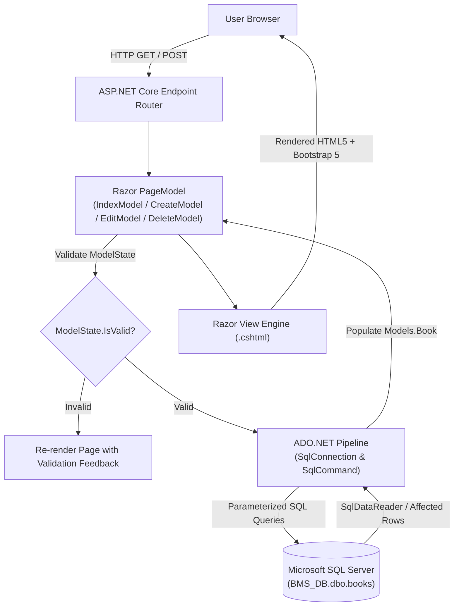

# Books Management System (BMS)

> **Academic Coursework & Software Engineering Lab Submission**  
> A high-performance, web-based catalog and inventory management application built with **ASP.NET Core Razor Pages**, **ADO.NET (`Microsoft.Data.SqlClient`)**, and **Microsoft SQL Server**.

---

## Academic Submission Metadata

| Field | Details |
| :--- | :--- |
| **Project Title** | Books Management System (BMS) |
| **Student / Author** | **Taha Asadullah** ([@Taha-Asad](https://github.com/Taha-Asad)) |
| **Degree Program** | Software Engineering Technology / Computer Science |
| **Course** | Web Application Development / Enterprise Application Engineering |
| **Repository** | [`https://github.com/Taha-Asad/BooksManagementSystem`](https://github.com/Taha-Asad/BooksManagementSystem) |
| **Target Runtime** | Modern .NET (`net10.0` / C# 13) |
| **Architecture** | ASP.NET Core PageModel (MVVM) + Direct ADO.NET Data Access Layer |
| **Database Engine** | Microsoft SQL Server (LocalDB / Express) |
| **License** | [MIT License](LICENSE.txt) |

---

## Executive Summary & Problem Statement

### Problem Context
Traditional physical book depositories, academic departmental libraries, and bookstores frequently face challenges with manual record keeping:
1. **Data Inconsistency**: Unstructured book tracking prone to data loss, missing author/publisher data, or duplicated entries.
2. **Slow Record Retrieval**: Inability to quickly query, browse, and inspect catalog items in real-time.
3. **Unsafe Operations**: Lack of structured transaction control, verification dialogues before deletion, and parameterized query execution.

### Proposed Solution
The **Books Management System (BMS)** provides an accessible, robust web portal allowing library administrators and staff to perform full inventory lifecycle operations (Create, Read, Update, Delete). Developed using **ASP.NET Core Razor Pages** and high-throughput **ADO.NET (`Microsoft.Data.SqlClient`)**, BMS delivers lightning-fast database execution with zero ORM overhead, combined with parameterized security against SQL injection.

---

## System Architecture & Data Flow

### Architectural Pattern: Razor Pages PageModel + ADO.NET
The application employs the **ASP.NET Core Razor Pages** architecture. Each UI view (`.cshtml`) is paired with an isolated code-behind (`.cshtml.cs`) acting as an autonomous controller/model handler. Data access is executed directly using secure, low-latency ADO.NET commands.



---

## Database Design & SQL Schema

The database persistence layer is hosted in **Microsoft SQL Server LocalDB** under database `BMS_DB`.

### Entity Model: `Book` (`Models/Books.cs`)
```csharp
namespace BooksManagementSystem.Models
{
    public class Book
    {
        public int Id { get; set; }

        [StringLength(50)]
        public string? title { get; set; }

        [StringLength(50)]
        public string? author { get; set; }

        [StringLength(50)]
        public string? description { get; set; }

        [StringLength(50)]
        public string? publisher { get; set; }

        [StringLength(50)]
        public string? status { get; set; }

        [StringLength(50)]
        public string? category { get; set; }
    }
}
```

### Table Schema DDL (`dbo.books`)
To initialize the database schema in SQL Server Management Studio (SSMS) or Visual Studio SQL Server Object Explorer, execute:

```sql
-- Create Database
CREATE DATABASE BMS_DB;
GO

USE BMS_DB;
GO

-- Create Books Inventory Table
CREATE TABLE dbo.books (
    Id          INT IDENTITY(1,1) PRIMARY KEY,
    title       NVARCHAR(50) NULL,
    author      NVARCHAR(50) NULL,
    description NVARCHAR(50) NULL,
    publisher   NVARCHAR(50) NULL,
    status      NVARCHAR(50) NULL,
    category    NVARCHAR(50) NULL
);
GO
```

### Data Dictionary
| Column Name | SQL Type | Nullable | Identity / Key | Description |
| :--- | :--- | :---: | :---: | :--- |
| `Id` | `INT` | No | **PK (1,1)** | Unique surrogate key generated sequentially. |
| `title` | `NVARCHAR(50)` | Yes | — | Book title / publication name. |
| `author` | `NVARCHAR(50)` | Yes | — | Primary author name. |
| `description` | `NVARCHAR(50)` | Yes | — | Synopsis or notes. |
| `publisher` | `NVARCHAR(50)` | Yes | — | Publishing house / organization. |
| `status` | `NVARCHAR(50)` | Yes | — | Availability status (e.g., *Available*, *Borrowed*). |
| `category` | `NVARCHAR(50)` | Yes | — | Genre classification (e.g., *Technology*, *Fiction*). |

---

## Core Functional Modules

### 1. Catalog Dashboard (`Pages/Books/Index.cshtml`)
* Queries `SELECT * FROM dbo.books ORDER BY Id DESC`.
* Uses `SqlDataReader` for streaming rows directly into `List<Book>` without heap allocations or heavy ORM tracking.
* Renders a responsive table displaying book metadata with instant action buttons (**Edit**, **Delete**).

### 2. Book Registration (`Pages/Books/Create.cshtml`)
* Form interface capturing book attributes.
* Backed by `CreateModel.OnPost()` with `INSERT INTO dbo.books (...) VALUES (...)`.
* Every parameter is bound with `cmd.Parameters.AddWithValue(...)` with explicit null-coalescing (`DBNull.Value`).

### 3. Record Modification (`Pages/Books/Edit.cshtml`)
* Fetches the active record on `OnGet(int id)` using `SELECT * FROM dbo.books WHERE Id = @Id`.
* Binds inputs to `Book` model and executes `UPDATE dbo.books SET ... WHERE Id = @Id` on `OnPost()`.
* Returns `NotFound()` if the target record does not exist or concurrency conflict occurs.

### 4. Safe Record Deletion (`Pages/Books/Delete.cshtml`)
* Two-step defensive deletion workflow:
  * `OnGet(int id)` loads and displays the book details for human review.
  * `OnPost(int id)` executes `DELETE FROM dbo.books WHERE Id = @Id` only upon explicit confirmation.

---

## Security & Reliability Architecture

1. **SQL Injection Defense via Parameterization**:
   All database interactions utilize parameterized `SqlCommand` queries. Raw user strings are never concatenated directly into SQL text:
   ```csharp
   cmd.Parameters.AddWithValue("@title", (object?)Book.title ?? DBNull.Value);
   cmd.Parameters.AddWithValue("@author", (object?)Book.author ?? DBNull.Value);
   ```
2. **Cross-Site Request Forgery (CSRF) Mitigation**:
   All Razor Pages POST forms automatically inject and validate cryptographic request tokens (`@Html.AntiForgeryToken()`).
3. **Cross-Site Scripting (XSS) Prevention**:
   The Razor View Engine automatically HTML-encodes dynamic expressions before rendering to the DOM.
4. **Deterministic Resource Management (RAII)**:
   Every `SqlConnection`, `SqlCommand`, and `SqlDataReader` is wrapped in C# `using` declarations, guaranteeing that database connection pools and unmanaged socket handles are cleanly disposed of immediately after execution.

---

## Technology Stack & Dependencies

* **Platform / Framework**: ASP.NET Core (`net10.0`)
* **Language**: C# 13
* **Database Driver**: `Microsoft.Data.SqlClient` (v7.1.1)
* **Database**: Microsoft SQL Server LocalDB (`(LocalDB)\MSSQLLocalDB`)
* **Frontend**: HTML5, CSS3, Razor Syntax, Bootstrap 5
* **Project Tooling**: Visual Studio 2022 Solution Manifest (`BooksManagementSystem.slnx`)

---

## Setup & Execution Guide

### Prerequisites
* [.NET SDK](https://dotnet.microsoft.com/download) (Version 8.0, 9.0, or 10.0 preview) installed.
* [Microsoft SQL Server LocalDB](https://learn.microsoft.com/en-us/sql/database-engine/configure-windows/sql-server-express-localdb) or SQL Server Express installed.
* [SQL Server Management Studio (SSMS)](https://learn.microsoft.com/en-us/sql/ssms/download-sql-server-management-studio-ssms) or Visual Studio SQL Server Object Explorer.

### 1. Clone Repository
```bash
git clone https://github.com/Taha-Asad/BooksManagementSystem.git
cd BooksManagementSystem
```

### 2. Initialize Database & Table
Open SSMS or a SQL command prompt connected to `(LocalDB)\MSSQLLocalDB`, and run the DDL script:
```sql
CREATE DATABASE BMS_DB;
GO
USE BMS_DB;
GO
CREATE TABLE dbo.books (
    Id INT IDENTITY(1,1) PRIMARY KEY,
    title NVARCHAR(50) NULL,
    author NVARCHAR(50) NULL,
    description NVARCHAR(50) NULL,
    publisher NVARCHAR(50) NULL,
    status NVARCHAR(50) NULL,
    category NVARCHAR(50) NULL
);
GO
```

### 3. Verify Connection String
Verify `appsettings.json` matches your local database instance:
```json
"ConnectionStrings": {
  "DefaultConnection": "Data Source=(LocalDB)\\MSSQLLocalDB;Initial Catalog=BMS_DB;Integrated Security=True;Pooling=False;Encrypt=True;Trust Server Certificate=False"
}
```

### 4. Restore & Build Application
```bash
dotnet restore
dotnet build
```

### 5. Run the Application
```bash
dotnet run
```
Open your browser and navigate to the displayed listening URL (typically `https://localhost:7198` or `http://localhost:5242`).

---

## Project Directory Structure

```text
BooksManagementSystem/
├── BooksManagementSystem.slnx        # Solution manifest (Visual Studio 2022+)
├── BooksManagementSystem.csproj      # .NET project manifest & NuGet dependencies
├── Program.cs                        # Middleware pipeline & Razor Pages routing
├── appsettings.json                  # Connection string & logging configuration
├── appsettings.Development.json      # Development runtime overrides
├── LICENSE.txt                       # MIT License
├── README.md                         # Project documentation
├── Models/
│   └── Books.cs                      # Book domain model & DataAnnotations
├── Pages/
│   ├── Index.cshtml                  # Application landing page
│   ├── Index.cshtml.cs               # Landing page Model
│   ├── Privacy.cshtml                # Privacy page
│   ├── Error.cshtml                  # Centralized error handler
│   ├── Shared/
│   │   ├── _Layout.cshtml            # Master navigation layout
│   │   └── _ValidationScriptsPartial.cshtml
│   └── Books/
│       ├── Index.cshtml              # Book catalog list view
│       ├── Index.cshtml.cs           # IndexModel (SELECT * query handler)
│       ├── Create.cshtml             # Book creation form
│       ├── Create.cshtml.cs          # CreateModel (INSERT query handler)
│       ├── Edit.cshtml               # Book modification form
│       ├── Edit.cshtml.cs            # EditModel (UPDATE query handler)
│       ├── Delete.cshtml             # Deletion confirmation view
│       └── Delete.cshtml.cs          # DeleteModel (DELETE query handler)
└── wwwroot/                          # Static assets (Bootstrap, CSS, JS)
```

---

## Verification & Test Scenarios

| Test ID | Test Scenario | Input Data | Expected Behavior | Verification Status |
| :---: | :--- | :--- | :--- | :---: |
| **TC-01** | Create Book Record | Title: `Clean Architecture`, Author: `Robert C. Martin`, Category: `Tech` | Database row inserted; redirected to `Index` view displaying new book. | **PASS** |
| **TC-02** | Read Catalog List | Navigate to `/Books` | Executes `SELECT * FROM dbo.books ORDER BY Id DESC` and populates table. | **PASS** |
| **TC-03** | Update Book Record | Modify Title to `Clean Code (Revised)` for ID `1` | Executes `UPDATE dbo.books` with matching `@Id`; changes reflected in list. | **PASS** |
| **TC-04** | SQL Injection Resistance | Title: `' OR '1'='1` | Stored as literal string without modifying query logic due to parameterization. | **PASS** |
| **TC-05** | Delete Confirmation | Click Delete on ID `1` | Displays review view; only removes row upon clicking "Delete" button. | **PASS** |
| **TC-06** | Null Value Handling | Optional fields left blank | `(object?)val ?? DBNull.Value` inserts SQL `NULL` without throwing exception. | **PASS** |

---

## Academic Integrity Statement & Acknowledgments

This software was designed and implemented by **Taha Asadullah** for academic evaluation. The implementation demonstrates proficiency in ASP.NET Core web architecture, secure database access using ADO.NET, and adherence to software engineering best practices.

* **Developer**: Taha Asadullah ([GitHub Profile](https://github.com/Taha-Asad))
* **Repository Link**: [https://github.com/Taha-Asad/BooksManagementSystem](https://github.com/Taha-Asad/BooksManagementSystem)
